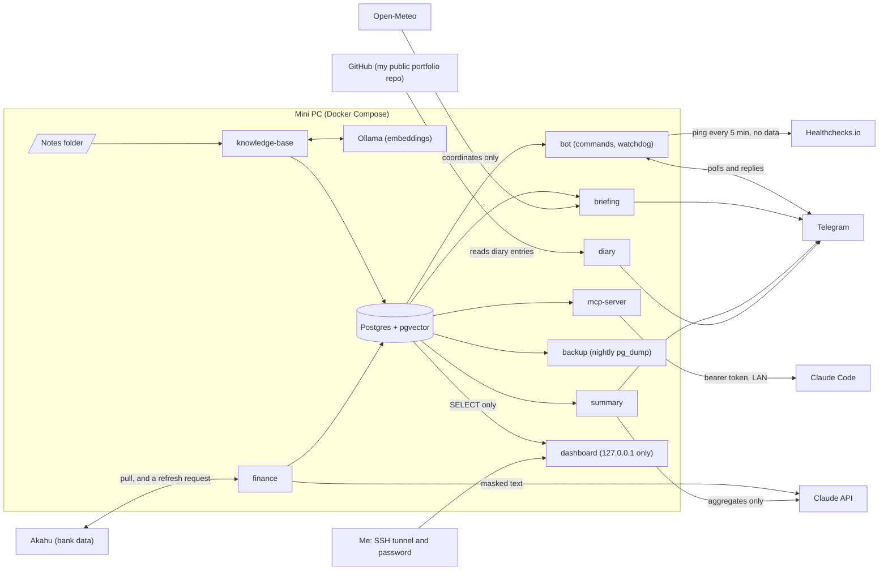

# Personal Ops Platform

A self-hosted personal platform on my home mini PC. It has a shared Postgres + pgvector data layer and an MCP server, so Claude can search my notes and query my finances, a Telegram bot that sends me a daily briefing and a weekly spending summary and answers a few commands, a payday plan with savings goals and spending alerts, and a read-only dashboard.

Status: complete and running on my mini PC: foundation, knowledge base, finance agent, daily briefing, command bot, status alerts with an outside check, a daily diary message, a read-only dashboard, and a payday plan with savings goals and spending alerts. See [docs/brief.md](docs/brief.md) for the full plan and the [risk assessment](RISK_ASSESSMENT.md) for what could go wrong and what I accepted.

## Why I built it

I wanted Claude to answer from my own notes and my own bank data, and I did not want either handed over wholesale to a hosted service. So the data lives in Postgres on a mini PC at home, the search runs there, and only the minimum goes to the Claude API: masked descriptions and amounts to categorise a transaction, and totals to write a weekly summary. Notes are embedded locally and never leave.

It is also a portfolio project, so each step is its own pull request with tests, and the controls are proven by breaking them on purpose and watching a test fail.

## How it fits together



Each module exposes functions from its own package. The MCP server, the briefing and the summary call those functions and never read another module's tables. The [design decisions](#design-decisions) below explain the choices that shaped this.

## What works now

- Claude connects to the MCP server over streamable HTTP (bearer token) or stdio.
- My notes folder (Markdown, text and PDF) is indexed automatically and kept in sync as files change. Claude can search it and answer from it, citing the file and heading each passage came from.
- Embeddings run locally with Ollama, so note text never leaves the mini PC.
- Bank transactions sync from Akahu (NZ open banking) daily at 08:00 NZ time, and again quietly at 00:05 so the day that has just ended is in. Akahu pulls from the bank on its own schedule, which is later than 08:00, so the sync first asks it to refresh and waits up to 3 minutes. My own rules categorise them first and Claude Haiku categorises the rest. The night sync sends no alerts.
- Claude can answer questions like "how much did I spend on groceries last month", list my recurring charges, and look up transactions.
- I set a spending target for each fortnight from Telegram. When this fortnight's spending, not counting rent and bills, passes 80% of it and again at 100%, one message arrives after the 08:00 sync. Each level is sent once per fortnight.
- Every morning at 08:30 NZ time a briefing arrives on Telegram: yesterday's spending and any unusual charge, this fortnight's spending against the target, when the bank data was last pulled, notes that changed in the last day, and today's weather. A section that fails is skipped and shown as unavailable, and the rest still send.
- Every morning at 09:00 NZ time a second message lists the previous day's diary entries (title and bullets), and nothing arrives on a day with no entry.
- The morning after each payday (every 14 days from a date I set) a message at about 08:00 NZ time suggests how to split my pay: rent and bills stay fixed, and whatever I spent under my spending target is added to savings and investments in their usual ratio. The savings part is shared between my goals by weight. It only suggests, because Akahu is read-only, and it sends once per payday even across a restart. See [the payday plan](#the-payday-plan).
- Every Monday at 08:00 NZ time a summary of the week's spending arrives on Telegram as a separate message.
- A read-only dashboard shows this fortnight against my spending target, my savings goals, spending by category, the last six months, subscriptions and job health. It listens on `127.0.0.1` only, so I open it through an SSH tunnel and a password. See [the dashboard](#the-dashboard).
- I can message the bot from my own Telegram chat and get answers back: spending, subscriptions, matching notes, or the briefing on demand. See [Telegram commands](#telegram-commands).

## MCP tools

| Tool                                       | What it does                                                                                                                  |
| ------------------------------------------ | ----------------------------------------------------------------------------------------------------------------------------- |
| `ping`                                     | Health check, including whether the database is reachable                                                                     |
| `search_notes(query, limit)`               | Semantic search. Returns passages with file path, heading, note id and score                                                  |
| `get_note(id)`                             | Full text of one note (truncated past 50,000 characters)                                                                      |
| `list_recent_notes(n)`                     | Most recently modified notes, newest first                                                                                    |
| `get_spending(period or dates, category?)` | Spending by category for a period (NZ calendar), plus income and money invested. Transfers and investments are reported apart |
| `list_subscriptions(include_inactive)`     | Recurring charges with cadence, typical amount and next expected date                                                         |
| `get_transactions(filters)`                | Transactions, newest first, filtered by period, category, text and amount. Digits in descriptions are masked                  |
| `add_category_rule(pattern, category)`     | Always put matching transactions into a category. Overrides the model                                                         |
| `list_category_rules()`                    | Rules with how many transactions each matches                                                                                 |
| `remove_category_rule(pattern)`            | Delete a rule. Its transactions go back to the model                                                                          |

Only the two rule-editing tools change data, and they can only change categories: no deletes, nothing sent anywhere, every change logged and reversible. That limit matters because transaction descriptions are partly written by whoever pays me, so text Claude reads from them is untrusted.

## Telegram commands

Send these to the bot from my own private chat. Every other chat is ignored with no reply.

| Command                            | What it does                                                                 |
| ---------------------------------- | ---------------------------------------------------------------------------- |
| `/spend [period] [category]`       | Spending by category, default this month. `/spend last month groceries`      |
| `/subs [all]`                      | Active recurring charges, or all of them                                     |
| `/notes <words>`                   | Titles and paths of matching notes. Never note text                          |
| `/briefing`                        | Sends the daily briefing now                                                 |
| `/payday`                          | The pay split, worked out from what I spent this fortnight                   |
| `/payday set <item> <amount>`      | Set the pay, rent, savings, invest or spending target. Several pairs at once |
| `/payday set payday <date>`        | The date of one payday. Paydays fall every 14 days from it                   |
| `/goal`                            | List the savings goals                                                       |
| `/goal add <name> <target> [date]` | Add a goal. Also `/goal saved`, `/goal weight` and `/goal remove`            |
| `/status`                          | When each job last succeeded, and which are stale                            |
| `/help`                            | Lists the commands, periods and categories                                   |

The commands use no model. Only `/payday set` and the `/goal` commands change anything, and only my payday settings and goals. An amount is plain digits, at most two decimals, over 0, and a date is `YYYY-MM-DD`. When one message sets several things, every pair is checked before any is saved. Arguments must match the period names and the category list, and nothing is passed on as free text. See [the ADR](docs/adr/0007-telegram-command-bot.md) for the allowlist, the rate limit and what I left out.

## Services (Docker Compose)

| Service          | Role                                                                                                                                                                                                                                                                                |
| ---------------- | ----------------------------------------------------------------------------------------------------------------------------------------------------------------------------------------------------------------------------------------------------------------------------------- |
| `db`             | Postgres 17 with pgvector. Published on 127.0.0.1 only                                                                                                                                                                                                                              |
| `migrate`        | One-shot: runs the SQL migrations, then exits                                                                                                                                                                                                                                       |
| `ollama`         | Embeddings model server (`nomic-embed-text`). No published port                                                                                                                                                                                                                     |
| `ollama-pull`    | One-shot: downloads the model into a volume, then exits                                                                                                                                                                                                                             |
| `backup`         | Dumps the database at startup and nightly at 03:00 NZ time, keeping 14 days                                                                                                                                                                                                         |
| `knowledge-base` | Scans the notes folder at startup, watches it for changes, and rescans every 15 minutes                                                                                                                                                                                             |
| `finance`        | Asks Akahu to refresh, then syncs accounts and transactions at startup, daily at `FINANCE_SYNC_TIME` (default 08:00 NZ time) and quietly at `FINANCE_NIGHT_SYNC_TIME` (default 00:05). Then categorises, and sends the spending alert and the payday message after the morning sync |
| `bot`            | Polls Telegram for my commands and answers them, and runs the watchdog. Outbound only                                                                                                                                                                                               |
| `briefing`       | Sends the daily briefing to Telegram at `BRIEFING_TIME` (default 08:30 NZ time)                                                                                                                                                                                                     |
| `diary`          | Sends yesterday's diary entries to Telegram at `DIARY_TIME` (default 09:00 NZ time)                                                                                                                                                                                                 |
| `dashboard`      | The read-only web page. Published on 127.0.0.1 only, reached through an SSH tunnel. Connects as a role that can only `SELECT`                                                                                                                                                       |
| `summary`        | Sends the weekly spending summary to Telegram, Monday 08:00 NZ time                                                                                                                                                                                                                 |
| `mcp-server`     | The MCP server. Published on the address set by `MCP_PUBLISH_ADDR`                                                                                                                                                                                                                  |

The app services run from one image as a non-root user, with a read-only filesystem, all capabilities dropped and `no-new-privileges`. The notes folder is mounted read-only.

## What leaves the mini PC

| Data                                        | Goes to                       | What is sent                                                                                                                                |
| ------------------------------------------- | ----------------------------- | ------------------------------------------------------------------------------------------------------------------------------------------- |
| Notes                                       | Nowhere                       | Embedded locally with Ollama                                                                                                                |
| Transactions, for categorisation            | Claude API (Haiku)            | Masked description, amount, type, and Akahu's merchant and category names. No account numbers or account names                              |
| Weekly summary                              | Claude API (Sonnet), Telegram | Totals, category sums, and a few payee names with digits masked. No transaction rows or descriptions. The finished message goes to Telegram |
| Weather                                     | Open-Meteo                    | Latitude and longitude only (suburb level). No key, no account                                                                              |
| Telegram commands                           | Telegram                      | My question, and the answer: totals, subscription lines, and note titles and paths. No transaction lines or note text                       |
| Bank refresh                                | Akahu                         | An authenticated request to refresh my accounts, with no other data                                                                         |
| Heartbeat ping                              | Healthchecks.io               | An empty request every 5 minutes. It tells them the box is up, and carries no data                                                          |
| Diary entries                               | GitHub (reads)                | A request for one public file, with no credentials. My text comes in, nothing goes out                                                      |
| Anything Claude reads through the MCP tools | The Claude chat I'm using     | What the tool returns, with digits masked in descriptions                                                                                   |

Account numbers and holder names are kept out by construction: the Akahu parser never reads them, and the table has no column for them. The `meta` block is not parsed at all, because it carries other people's account numbers.

## Design decisions

Short records of the choices that shaped the project, with what I rejected and what each costs:

1. [One TypeScript monorepo on one Postgres](docs/adr/0001-stack.md)
2. [Embed notes locally with Ollama](docs/adr/0002-local-embeddings.md)
3. [Bearer tokens and a Host allowlist for the MCP server](docs/adr/0003-mcp-auth.md)
4. [Data model: versioned vectors, and transactions that follow the source](docs/adr/0004-data-model.md)
5. [What leaves the box: masking, aggregates and a small write surface](docs/adr/0005-finance-privacy.md)
6. [A daily briefing built from plain code, and a separate weekly summary](docs/adr/0006-briefing-without-a-model.md)
7. [A Telegram bot that answers fixed commands, for me only](docs/adr/0007-telegram-command-bot.md)
8. [Heartbeats and a watchdog, so a silent failure becomes a message](docs/adr/0008-heartbeats-and-watchdog.md), with an update for the outside check
9. [Yesterday's diary entries as their own morning message](docs/adr/0009-diary-message.md)
10. [Decisions from the threat model: an audit line, one token, no rate limit](docs/adr/0010-threat-model-decisions.md)
11. [Budgets and a read-only dashboard](docs/adr/0011-budgets-and-dashboard.md), where the budgets were later replaced
12. [A payday plan and savings goals](docs/adr/0012-payday-plan-and-savings-goals.md)

## Setup

1. Install Docker with Compose.
2. Clone the repo and `cp .env.example .env`. Keep `.env` at `chmod 600`.
3. Fill in `.env`: a Postgres password, and `MCP_AUTH_TOKENS` (generate one with `openssl rand -hex 32`).
4. Create the backups folder as your user, `mkdir backups`, so Docker doesn't create it owned by root. Set `NOTES_DIR` to your notes folder. It defaults to `./notes`, which git ignores.
5. For finance, add the Akahu app and user tokens (my.akahu.nz, personal app). Add an `ANTHROPIC_API_KEY` to categorise with the model. Without one, sync and rules still work and new transactions stay uncategorised.
6. For the Telegram summary, create a bot with @BotFather, send it a message, and read your chat id from the bot's `getUpdates`. Set `TELEGRAM_BOT_TOKEN` and `TELEGRAM_CHAT_ID`. `CLAUDE_SUMMARY_MODEL` defaults to `claude-sonnet-5-5`. The daily briefing and the command bot use the same bot and chat. Only the weekly summary uses a model. Set `WEATHER_LAT` and `WEATHER_LON` (suburb level is enough), and optionally `BRIEFING_TIME` (24-hour NZ time, default 08:30), `DIARY_TIME` (default 09:00) and `FINANCE_SYNC_TIME` (default 08:00). Optionally create a check at healthchecks.io with a 5 minute period and 10 minute grace, add your email as its alert channel, and set `HEALTHCHECK_PING_URL` to its ping URL.
7. For the dashboard, set `DASHBOARD_PASSWORD` (at least 20 characters, `openssl rand -hex 24`). Compose refuses to start any service until it is set. Optionally set `DASHBOARD_HIDE_PAYEES=true` to hide payee names for screenshots, and `FINANCE_NIGHT_SYNC_TIME` (default `00:05`, empty turns it off).
8. On the mini PC, set `MCP_PUBLISH_ADDR` and `MCP_ALLOWED_HOSTS` to its LAN IP, and allow the port through the firewall.
9. `docker compose up -d --build`. The first run downloads the model (about 274 MB), indexes every note and syncs transactions from `FINANCE_HISTORY_START`.
10. Add the server to Claude Code: `claude mcp add --scope user --transport http personal-ops-lan http://<host>:3000/mcp --header "Authorization: Bearer <token>"`

For development: `corepack pnpm install`, then `corepack pnpm test`. Integration tests run against Postgres when `DATABASE_URL` is set, in a throwaway schema built from the real migrations.

To send a summary, briefing or diary message now, run `docker compose exec summary node packages/finance/dist/summary-main.js --once`, `docker compose exec briefing node packages/briefing/dist/briefing-main.js --once` or `docker compose exec diary node packages/briefing/dist/diary-main.js --once` (add `--day=2026-10-12` to choose the day).

## The payday plan

I am paid every fortnight and want to spend less and save more, so the message that matters comes the morning after pay. Settings and goals live in the database and are set from the bot, so my pay and amounts are never in the repo or `.env`.

- **The split.** Rent and bills are a fixed amount that never changes. Spending is what I spent in the 14 days ending on payday, leaving out Housing, Utilities, Insurance, Transfers and Investments. If that is under my spending target, the difference is added to savings and investments in their usual ratio. If it is over, the message says by how much and shows the usual amounts. Everything is whole cents, and any odd cent goes to savings.
- **Goals.** A goal has a name, a target, an optional date, an amount saved that I update by hand, and a weight from 1 to 10. The savings part is shared by weight across goals that are not full, and a full goal stops receiving money.
- **The meter.** This fortnight's spending so far against the target shows on the dashboard and in the morning briefing, and sends one alert at 80% and one at 100%.
- **Timing.** The pay lands in the evening, so the message waits until the morning sync has pulled it. It records the payday it covered, so it never repeats. If the pay is not in my data yet, the message says so and uses the pay I set.
- **Budgets are gone.** They are replaced by the target and the goals. See [ADR 12](docs/adr/0012-payday-plan-and-savings-goals.md) for the options I rejected.

## The dashboard

A read-only page for what I would otherwise ask the bot: this fortnight against my spending target, my savings goals, spending by category, the last six months, subscriptions and job health. It also shows when the bank data was last pulled. It is plain `node:http` with no framework, and the charts are inline SVG, so it needs no script and no outside file.

It listens on `127.0.0.1` on the mini PC, so it is not reachable over the LAN. To open it:

```sh
ssh -L 8081:localhost:3100 owner@<mini PC>
```

Then browse to `http://localhost:8081` and give any user name and `DASHBOARD_PASSWORD`.

Every request is checked in this order: the Host name against an allowlist, the method (GET and HEAD only), the password (one password, constant-time compare), then a fixed list of two paths. The page connects to Postgres as `dashboard_ro`, a role with `SELECT` on five tables and nothing else. Everything from the database is HTML-escaped, payee names have their digits masked, and the content security policy allows no inline script or style. See [ADR 11](docs/adr/0011-budgets-and-dashboard.md), and [batch D of the security testing](docs/security-testing.md#batch-d-the-dashboard-and-the-budget-commands).

## Backups

`backup` writes `pg_dump -Fc` files to `BACKUP_DIR` (default `./backups`, git-ignored) as the host user, readable only by that user. Set `BACKUP_UID` and `BACKUP_GID` from `id -u` and `id -g`.

Restore into a scratch database to check a dump, or into the real one to recover:

```sh
docker compose exec -T db sh -c 'createdb -U "$POSTGRES_USER" restore_check'
docker compose exec -T db sh -c 'pg_restore -U "$POSTGRES_USER" -d restore_check --no-owner' < backups/<file>.dump
```

The backups sit on the same disk as the database, so they cover mistakes and corruption, not a dead disk.

## Security notes

The [risk assessment](RISK_ASSESSMENT.md) lists what I am protecting, what could go wrong, the controls in place, the risks I accepted and what is still open.

- The mini PC runs only what it needs. A port scan from another machine on the LAN finds just SSH (22) and the MCP server (3000). The dashboard's port is on 127.0.0.1 and does not show. The printing and modem services are disabled, the old build agent's folder is deleted, and unattended upgrades include Ubuntu's security pocket, which Linux Mint's default config misses. Avahi (`.local` names) is left running.

- I wrote a [threat model](docs/threat-model.md), then attacked my own server and tools with about 230 tests and wrote up every result, including the 17 findings I fixed, in [docs/security-testing.md](docs/security-testing.md). The MCP server logs one audit line per request (the tool and the argument names, never the values) and logs failed token guesses.
- The repo is public. `main` is protected by a ruleset: changes need a pull request and a passing `check`, and force pushes and deletion are blocked. I proved it by trying a direct push and getting it rejected. Secret scanning with push protection and Dependabot alerts are on, and the history was scanned with gitleaks before and after going public. See [SECURITY.md](SECURITY.md) for reporting a problem.
- The dashboard is a new entry point, so it had its own section of the threat model and its own attack tests (batch D), which found no bypass. It answers only GET and HEAD to two paths behind a password and a Host allowlist, escapes everything from the database, and connects as a role that cannot write. I proved the role on the live box with `INSERT`, `DELETE` and a read of a table it should not see, each in a transaction I rolled back.
- Bearer tokens are hashed before a constant-time compare. `MCP_AUTH_TOKENS` takes several tokens so one can be rotated in before the old one is removed.
- A Host header allowlist protects against DNS rebinding.
- gitleaks runs as a pre-commit hook and again in CI. CI actions are pinned by commit SHA, and images by digest.
- CI pulls its Postgres image from a GHCR copy (same digest as Docker Hub's), because Docker Hub rate-limited and timed out on GitHub's runners.
- Descriptions are masked before they leave the box: runs of 6 or more digits become `[number]`, and anything after the bank's own run of asterisks becomes `[card]`. A test checks the weekly summary's digest contains no account name, card number or description text.
- The category list is a real `enum` in the JSON schema sent to the API. The SDK's zod helper turned it into a description, so the schema is written by hand and a test checks the MCP tools carry the enum too.
- The command bot answers only my private chat (chat id and sender id must both match), ignores everyone else without replying, handles at most 10 messages a minute, and runs fixed read-only commands with validated arguments. I proved the allowlist live by running a copy with a wrong chat id and getting no reply.
- Each job records a heartbeat in a `job_runs` table (last success and last attempt, no error text). `/status` and a watchdog in the `bot` service share one set of staleness limits, send one alert per incident and one "working again", and carry only the job name and age. I proved it live by backdating a heartbeat and getting the alert, then the all-clear.
- The watchdog's own blind spot is covered from outside. The bot pings Healthchecks.io after each check that worked, and it emails me when the pings stop. No ping is sent if the check itself fails, and the ping URL is a secret that never appears in a log or an error. I proved it by stopping the bot and waiting for the email.
- The diary message reads one fixed public GitHub URL with a timeout and a size cap, and parses the file without running it. A file that parses to nothing is an error that the watchdog turns into an alert.
- Config errors name the variable and never print its value, including the Telegram token and chat id. Telegram send errors carry Telegram's description only, because the request URL contains the token.

## Known limits

- The Claude API key expires on 1 January 2027. When it does, transactions keep syncing and rules keep working, but new transactions stay uncategorised, and the weekly summary falls back to plain numbers, until the key is replaced.
- Names in person-to-person payments are sent to the model as written, both for categorisation and as payee names in the weekly summary.
- Closed accounts are not returned by Akahu's API, so a closed credit card's history is missing and spending on it is not counted. Payments to it count as transfers.
- Transactions older than `FINANCE_HISTORY_START` (default 2026-01-01) are not kept. Moving it later deletes older local copies on the next sync.
- The spending target is one amount for the whole fortnight, not per category, and an alert can arrive up to a day after the spending, because it is sent after a sync. The 80% alert can fire early in a fortnight if a few large purchases land together.
- What a goal has saved is what I tell the bot, not read from the bank, so it can drift from my real savings until I correct it. The payday message only suggests: I make the transfers, because Akahu is read-only for me.
- The payday schedule is a fixed date plus 14 days. If my pay changes, I change the date. If a send fails, it is tried again at each morning sync for three more days, then skipped.
- The dashboard is only reachable through an SSH tunnel, so I can't open it on my phone. Its read-only role is set when each connection starts, so a session that could run arbitrary SQL could switch to my login user. It runs fixed queries only. A login role with its own password would close that. Category names on the page are not masked, because only my rules and the model can set a category and both use a fixed list.
- Akahu pulls from the bank about once a day and stamps most transactions 23:59:59, so a transaction appears in my data after its day ends. The sync asks Akahu to refresh first, which Akahu may ignore inside its one hour rest period.
- Recurring-charge and anomaly detection are plain heuristics with fixed thresholds. They are tuned on one person's data.
- A failed summary or briefing send is retried every hour. If a job stays stale past its limit, the watchdog messages me once (see [the ADR](docs/adr/0008-heartbeats-and-watchdog.md)). It lives in the `bot` service and sends through Telegram, so an outside check pings Healthchecks.io and emails me if the bot, its database connection or the watchdog loop stops. If Healthchecks is down at the same time as the box, nothing alerts me. The briefing's schedule and retry loop have no automated test, only a manual `--once` run.
- The briefing's notes section reports file modification time, so it can't tell a new note from an edited one. Its finance section ends with when Akahu last pulled from the bank. Akahu's personal apps have a one hour rest period, so a refresh request inside it is ignored, and a refresh that takes over 3 minutes is not waited for.
- A section that times out keeps running in the background until it finishes. None of the current sections hold a connection open.
- On Mondays the briefing, the diary message and the weekly summary arrive as three separate messages.
- The diary message is only as fresh as my last push to my-portfolio's `main`, and its parser depends on that file's formatting. If the layout changes it fails loudly rather than going quiet.
- The bot token is the real secret for the command bot: whoever holds it can read my messages to it. Telegram sees my questions and the answers, and messages sent while the bot is down are answered when it restarts. Only one copy can poll at a time.
- Traffic between Claude and the mini PC is plain HTTP on the home LAN. TLS or a Tailscale-only bind would be the production fix.
- The mini PC has no disk encryption. Encrypting an existing root disk means a reinstall, and the realistic threat is someone taking a home PC. I accepted that: the Akahu and API tokens can be revoked, `.env` is readable only by its owner, and the backups sit on the same disk. Revisit when the box is next rebuilt.
- SSH password login is left on, restricted to the LAN by the firewall and watched by fail2ban.
- On Docker Desktop for Mac, deleting a note doesn't reach the container, so the 15-minute rescan removes it. The mini PC's native Linux mount sees deletes straight away.
- The first index runs on CPU: 102 notes took about 25 minutes. Later scans skip unchanged files.
- Deleting the last note leaves it in the index. An empty folder looks like a missing mount, so the scan keeps the index rather than wiping it.
- Scanned PDFs with no text layer aren't indexed (no OCR).
- A note over 20 MB is skipped, links in the notes folder are never followed, and a path that leaves the folder is refused.
