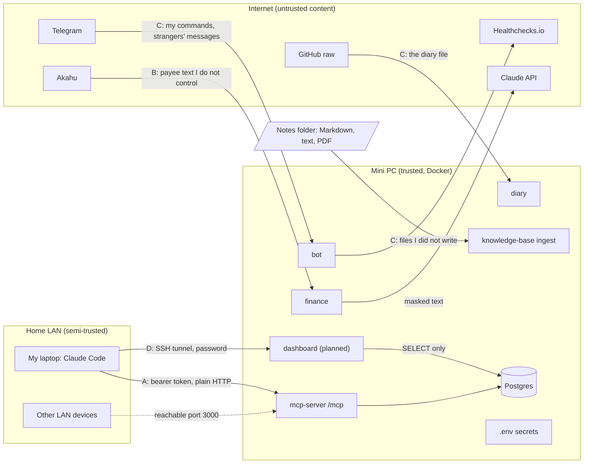

# Threat model

Status: **approved and used.** Reviewed and merged on 12 October 2026 before any attack work started. The results are in [security-testing.md](security-testing.md). Written 12 October 2026 from the code as it stands. It covers the Personal Ops Platform running on my mini PC. The [risk assessment](../RISK_ASSESSMENT.md) is the register of what I accepted. This document is the reasoning behind it: who could attack what, how, and what stops them. Where I have not checked a claim, it says "to test".

## What the system is

One TypeScript monorepo in Docker Compose on a home mini PC. A Postgres database holds notes, chunks and bank transactions. An MCP server lets Claude read both and change transaction categories. A Telegram bot, a daily briefing, a diary message and a weekly summary send me messages. A watchdog and an outside check watch the jobs.

## Trust boundaries

A, B and C match the test groups below. An arrow crossing a box edge is a place I have to treat input as hostile.

## Assets

| Asset                                 | What an attacker gains                                         |
| ------------------------------------- | -------------------------------------------------------------- |
| Transactions                          | How I live and what I spend                                    |
| Notes and diary                       | Private writing                                                |
| Category rules                        | The only data Claude can change: a way to make the numbers lie |
| Secrets in `.env`                     | Akahu, Anthropic, Telegram and MCP tokens, and the ping URL    |
| The ability to make Claude act        | Steering Claude through text it reads (prompt injection)       |
| Availability and the alert path       | Hiding that something broke                                    |
| A foothold on the mini PC and the LAN | Pivoting from a container to the rest of my home network       |

## Who might attack, and what they want

| Attacker                             | Can reach                                        | Wants                                                        |
| ------------------------------------ | ------------------------------------------------ | ------------------------------------------------------------ |
| A device or guest on my home network | Port 3000, and plain HTTP traffic on the LAN     | The bearer token, then my data and the rule tools            |
| A stranger on the internet           | The public repo, pull requests, the bot's name   | A reply from the bot, a leaked secret, a poisoned dependency |
| Whoever writes text I ingest         | Payee names, note content, a PDF, the diary file | To steer Claude, crash a parser, or smuggle data out         |
| A compromised dependency or upstream | Build, runtime and API responses                 | Code execution in a container                                |

Out of scope here: someone with the mini PC in their hands or root on it (risk R7), and a compromise of Telegram, GitHub, Akahu or Anthropic themselves. I trust them with what the README says I send them.

## STRIDE by entry point

Each row has a test ID. Tests marked **to test** are hypotheses, not findings. A bypass is only real once a test shows it.

### A. The MCP server (`/mcp`, and stdio)

| ID  | STRIDE | Threat                                                                      | What stops it today                                                           | Gap or to test                                                                                     |
| --- | ------ | --------------------------------------------------------------------------- | ----------------------------------------------------------------------------- | -------------------------------------------------------------------------------------------------- |
| A1  | S      | A request with a missing, odd or repeated Authorization header gets through | A strict `Bearer <token>` match, tokens hashed then compared in constant time | **To test:** empty token, wrong case, extra spaces, two headers, a very long token                 |
| A2  | S      | Guessing the token                                                          | Tokens must be at least 32 characters                                         | **To test:** no limit on wrong guesses, and failed attempts do not appear to be logged. Likely gap |
| A3  | S      | DNS rebinding or a spoofed Host header reaches the server from a web page   | A Host allowlist from the MCP SDK                                             | **To test:** IP forms, ports, trailing dots, uppercase, and an Origin header                       |
| A4  | T      | A malformed or oversized JSON-RPC body breaks parsing or the process        | Validation in the MCP SDK and a generic 500                                   | **To test:** body size limit, invalid JSON, deeply nested JSON                                     |
| A5  | I      | An error response shows a stack trace, a path or a query                    | Errors return `internal error` and log the detail                             | **To test:** read the response to each failure above                                               |
| A6  | D      | Many requests or slow clients take the server down                          | Docker restarts it. No rate limit                                             | **To test locally only:** how it behaves under a burst. Accept or add a limit                      |
| A7  | T      | The wrong method on `/mcp`                                                  | GET, DELETE and others return 405                                             | **To test:** confirm                                                                               |
| A8  | R      | No record of which tool was called, with what, or by whom                   | None. Logs hold errors only                                                   | **Gap by design:** an audit log is a requirement in my own security brief. Decide and record       |
| A9  | E      | One valid token gives every tool, including the rule tools                  | The write tools can only change categories, with no deletes                   | **Accepted for now:** no per-tool scopes. Revisit with per-client tokens                           |

### B. Text I do not control, reaching Claude through the tools

| ID  | STRIDE | Threat                                                                           | What stops it today                                                                                 | Gap or to test                                                                                |
| --- | ------ | -------------------------------------------------------------------------------- | --------------------------------------------------------------------------------------------------- | --------------------------------------------------------------------------------------------- |
| B1  | T, E   | SQL injection through a search string, a rule pattern or an id                   | Zod input checks, and queries that I believe are parameterised                                      | **To test:** classic payloads in every string parameter, then check the database is unchanged |
| B2  | T      | LIKE wildcards or regex characters in a text filter match more than intended     | Rule matching uses `position()`, so `%` and `_` are plain                                           | **To test:** the same characters in the `search` filter of `get_transactions`                 |
| B3  | D      | Huge limits, negative numbers or long strings                                    | Limits are bounded (for example 1 to 100). Strings are capped at 100 characters                     | **To test:** values at and beyond each bound                                                  |
| B4  | T      | A rule with a category outside the list, or a pattern that matches everything    | The category is an enum, checked in the schema and again in the function                            | **To test:** a one-character pattern, a pattern of only spaces, and an unknown category       |
| B5  | I      | Digits survive the masking, so account or card numbers reach Claude or the model | Runs of 6 or more digits become `[number]`. Text after the bank's asterisks becomes `[card]`        | **To test:** numbers split by spaces or dashes (`4111 1111 1111 1111`), and non-ASCII digits  |
| B6  | E      | Text in a payee, a note or a PDF tells Claude to do something (prompt injection) | The tool descriptions call text data. Write tools are narrow and reversible. Claude Code asks first | **To test:** plant a payload in each source and see what the tool returns and how             |

### C. The bot, the diary file, and the files I ingest

| ID  | STRIDE | Threat                                                                                  | What stops it today                                                                                     | Gap or to test                                                                                                                                            |
| --- | ------ | --------------------------------------------------------------------------------------- | ------------------------------------------------------------------------------------------------------- | --------------------------------------------------------------------------------------------------------------------------------------------------------- |
| C1  | S, E   | A stranger or a group message gets a reply or runs a command                            | Private chat, chat id and sender id must match. Proved live                                             | **To test locally:** forged updates of every shape (edited messages, channel posts, forwards)                                                             |
| C2  | T, D   | A hostile command argument, a long message or a flood                                   | Fixed commands, arguments checked against lists, a 100 character cap, 10 a minute                       | **To test:** control characters, unicode tricks, mentions of the bot name, many messages                                                                  |
| C3  | T, D   | A crafted diary file crashes or stalls the parser, or fills memory                      | A fixed URL over HTTPS, a 15 second timeout, a 2 MB cap, parsed and never run                           | **To test:** very long lines, odd quoting, and a file that parses to nothing                                                                              |
| C4  | T, E   | A symlink or path in the notes folder makes ingest read a file outside it               | Hidden files are skipped. The folder is mounted read-only                                               | **To test:** symlinked files and folders, `..` names, odd characters in file names                                                                        |
| C5  | D      | A malformed or huge PDF crashes the scan or uses all the memory                         | Docker restarts a crashed container. Only Ollama has a memory limit, and there is no size cap on a file | **Likely gap:** the knowledge-base container has no memory limit. **To test:** a malformed PDF, a very large file, and what the next scan does afterwards |
| C6  | D      | Pathological Markdown (one enormous line, thousands of nested headings) stalls chunking | A chunk size limit                                                                                      | **To test:** time the chunker on hostile input                                                                                                            |
| C7  | I      | A secret ends up in a log or an error message                                           | Logger redaction, config errors that never print values, URL-free error messages                        | **To test:** set known fake secrets, force an error in each service, and search the logs                                                                  |
| C8  | S      | A forged or replayed response from Akahu, Anthropic or Open-Meteo                       | HTTPS, and responses validated with zod. The model's category must be on the list                       | **To test:** feed each parser a malformed response and confirm the job fails cleanly                                                                      |

### D. The dashboard and the budget commands (planned, [ADR 11](adr/0011-budgets-and-dashboard.md))

| ID  | STRIDE | Threat                                                                                 | What stops it today                                                     | Gap or to test                                                                                  |
| --- | ------ | -------------------------------------------------------------------------------------- | ----------------------------------------------------------------------- | ----------------------------------------------------------------------------------------------- |
| D1  | T, E   | A payee or payment reference with HTML or script runs in my browser (stored XSS)       | Not built yet. Plan: escape every value on output, a strict CSP         | **To test:** `<script>` and attribute-breaking payloads in a payee, a category and a note title |
| D2  | S      | A missing, wrong or near-match password gets a page                                    | Not built yet. Plan: constant-time compare, 401 with no detail          | **To test:** empty, wrong, prefix of the real one, two headers, a very long value               |
| D3  | S      | A spoofed Host header reaches the page from a web page (DNS rebinding)                 | Not built yet. Plan: Host allowlist, port bound to 127.0.0.1            | **To test:** IP forms, ports, trailing dots, uppercase                                          |
| D4  | T      | A write method or an odd path changes data or reads a file                             | Not built yet. Plan: GET only, a fixed route table, a read-only DB role | **To test:** POST, PUT, DELETE, `/../`, encoded dots, and an `INSERT` through the DB role       |
| D5  | I      | Digits survive masking and an account or card number shows on the page                 | Plan: reuse `maskDigits`                                                | **To test:** the B5 inputs against every page                                                   |
| D6  | I      | An error page shows a stack trace, a query or a path                                   | Plan: a generic 500, detail in the log                                  | **To test:** force an error in each route and read the response                                 |
| D7  | D      | A burst of requests, or a slow query, ties up the database                             | Plan: bounded queries, `mem_limit`, one small page                      | **To test locally only:** a burst against a throwaway database                                  |
| D8  | T      | A `/budget set` with a category off the list, a negative or huge amount, or odd digits | Plan: category checked against the enum, amount bounded                 | **To test:** `0`, `-5`, `1e9`, `NaN`, unicode digits, a category with different case            |
| D9  | D      | The same alert is sent again after a restart or a second sync                          | Plan: sent state stored in the database                                 | **To test:** two syncs in one month, a restart between them, and the month rolling over         |

## Threats I am not testing in this phase

- **The host and the network:** SSH, the firewall, disk encryption and the router are covered by the earlier hardening and risks R7, R15 and R17.
- **The supply chain:** dependency and image scanning belong to a later step (risk R13).
- **A free-text bot:** it does not exist. If I build it, it needs its own threat model and a red-team suite.

## Assumptions

- Only I use the system, and the single shared MCP token is mine.
- Docker's isolation holds. A container escape is out of scope.
- The notes folder holds files I put there. Anything I download into it (a PDF, a saved web page) counts as untrusted content.
- Every attack runs against a local copy with a throwaway database. The live mini PC gets only read-only checks, so the unattended jobs are never at risk.

## How this turns into work

1. **Batch A:** A1 to A7, run against a local copy of the HTTP server.
2. **Batch B:** B1 to B6, with planted payloads in a test database.
3. **Batch C:** C1 to C8.
4. A9 and A8 are decisions, not tests. I record each in an ADR whichever way it goes.
5. Every result goes into `docs/security-testing.md` as test, expected, actual, fix. A bypass gets a fix and a retest, and I report it plainly.

## Review

| Date        | Reviewer | Result                                                                                               |
| ----------- | -------- | ---------------------------------------------------------------------------------------------------- |
| 12 Oct 2026 | Me       | Approved by merging the draft. A8 and A9 decided in [ADR 10](adr/0010-threat-model-decisions.md)     |
| 13 Oct 2026 | Me       | Section D added for the budgets and dashboard phase, see [ADR 11](adr/0011-budgets-and-dashboard.md) |
